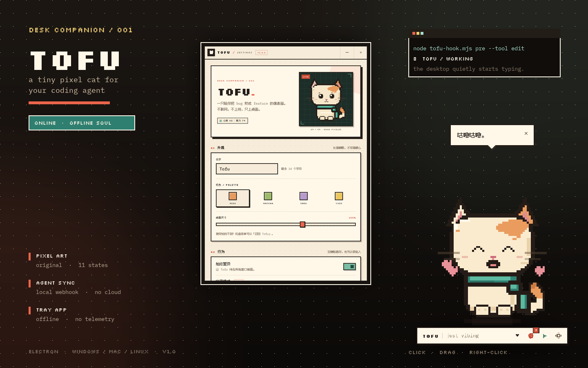
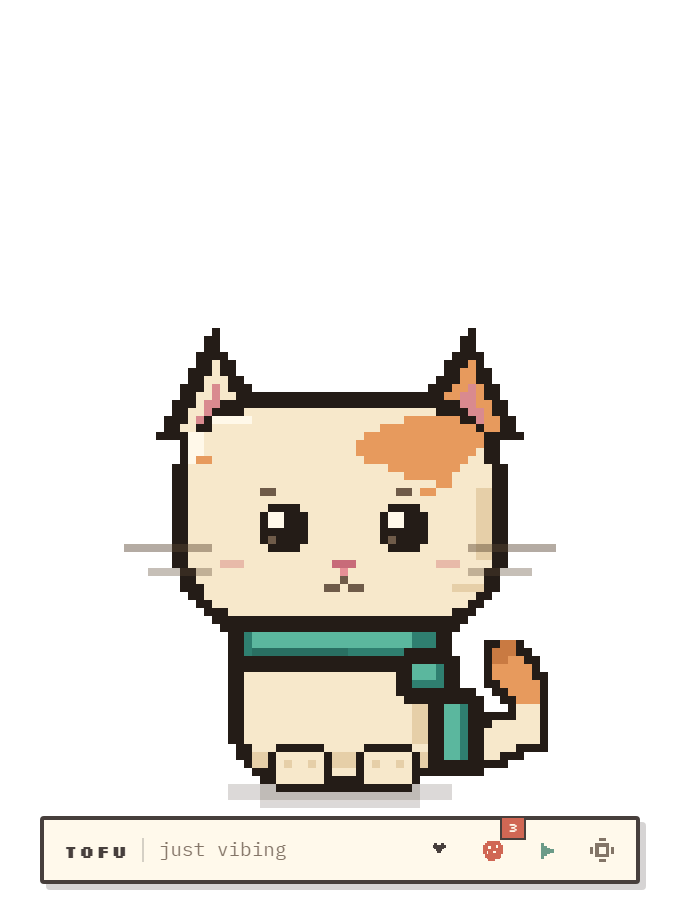
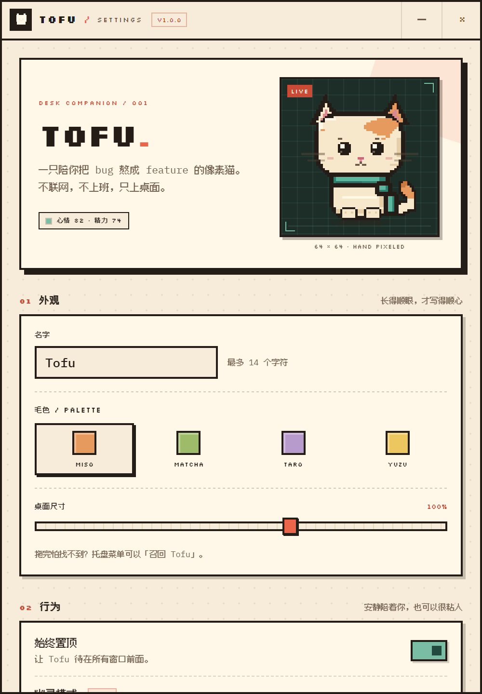

# TOFU · 桌面像素猫

> 一只会陪你把 bug 熬成 feature 的桌面宠物。手搓像素动画、透明置顶窗口、投喂系统，以及给 coding agent 用的本地 hook。



Tofu 的灵感来自 [Petdex](https://petdex.dev/) 那种「桌面上的小像素生物 + 编码助手联动」的体验，但这个项目是完全独立、从零写的：没有贴图包，没有联网服务，也没有遥测。猫的每一帧都由 Canvas 里的矩形实时画出来。

## 能做什么

- **浮在桌面上**：无边框透明窗口、始终置顶、跳过任务栏。透明区域点击穿透，只有猫、气泡和底部小 dock 会接住鼠标。
- **十一种像素状态**：发呆（带眨眼和呼吸）、开心、工作、审查、等待、报错、招手、跳跃、睡觉、吃东西、被拖走。眼睛会追着鼠标看。
- **真的能互动**：单击摸头、双击陪玩、拖动搬家、右键菜单、托盘投喂。心情/精力/饼干会随时间变化，并持久化。
- **和 coding agent 联动**：内置一个只监听 `127.0.0.1` 的 hook server。agent 跑到哪一步，Tofu 就在桌面上打字、拿放大镜，或者抬头等你确认。
- **DSH 原生插件**：仓库内含 `@tofu/dsh-bridge` Host-only bundle，安装后 DSH 的工具、turn、提问事件会自动同步；设置页有一键复制目录和安装指令。
- **离线且有边界**：不上传任何东西，不注入到你的编辑器，不修改 agent 配置。hook 服务器拒绝带 `Origin` 的浏览器请求。

| 桌面上的 Tofu | 设置面板 |
| --- | --- |
|  |  |

## 快速开始

需要 **Node.js 22+**。Windows 11 上完整测试过；Electron 负责跨平台，macOS / Linux 理论上可用。打包产物未做代码签名，Windows 第一次运行可能弹 SmartScreen。

```bash
npm install
npm start
```

第一次启动时 Tofu 会冒出一句自我介绍。找不到猫？看系统托盘里的猫脸图标，或按 `Ctrl + Alt + P` 召回。

```bash
npm run dist       # 打包 Windows x64 zip 到 release/
npm run smoke      # 无 GUI 的 smoke test（需要 Chrome）
```

> `npm start` 走的是 `scripts/launch.cjs`。它会剥掉终端里可能继承的 `ELECTRON_RUN_AS_NODE`，避免 Electron 被误当成普通 Node 启动；在 DSH/agent 的受限终端里还会自动补上 `--no-sandbox`。正常双击桌面应用不走这条路径。

## 操作

| 操作 | 效果 |
| --- | --- |
| 单击猫 | 摸摸，掉心心 |
| 双击猫 | 陪玩，跳一下 |
| 拖动猫 | 搬家，位置会记住 |
| 右键猫 / dock | 原生小菜单 |
| 托盘图标左键 | 显示 / 隐藏 |
| 托盘右键 | 投喂、摸摸、设置、幽灵模式、退出 |
| `Ctrl + Alt + P` | 显示 / 隐藏 Tofu |
| `Ctrl + Alt + ,` | 打开设置 |
| 设置 → 幽灵模式 | 点击穿透；从托盘菜单关闭 |

底部 dock 有三个快捷操作：摸头、投喂、陪玩；最右边是设置。饼干每两小时补一块，最多五块。

## 让 agent 联动

Tofu 启动后会在 `127.0.0.1:41234` 起一个本地事件服务（端口被占用时会自动往后找）。最简单的试用方式：

```bash
node bin/tofu-hook.mjs pre --tool edit
node bin/tofu-hook.mjs stop
node bin/tofu-hook.mjs bubble --text "build is green"
```

事件会立刻反映在桌面上：

| 事件 | Tofu 的反应 |
| --- | --- |
| `session-start` / `user-prompt` | 跳一下，开始工作 |
| `pre --tool read` / `grep` / `glob` | 拿放大镜审查 |
| `pre --tool edit` / `bash` / `write` | 打开小黑终端，爪子敲字 |
| `post` | 低头想一想 |
| `waiting` / `notification` | 抬头、举爪、问号，等你确认 |
| `stop` / `session-end` | 挥手，冒心心 |
| `failure` / `tool-failure` | 耳朵耷拉，掉眼泪 |
| `bubble --text "..."` | 只说一句话，不改状态 |

设置页 **03 助手联动** 会显示当前真实的命令（带绝对路径）和端口，并提供「演示一轮 / 完成 / 报错 / 等待确认」按钮。接 Claude Code 的完整 `settings.json` 示例见 **[docs/HOOKS.md](docs/HOOKS.md)**。

### DeepSeek Harness

Tofu 仓库里带了一个 DSH Host-only bundle：`integrations/dsh`（包名 `@tofu/dsh-bridge`）。在 Tofu 设置页的 **DeepSeek Harness** 卡片复制安装指令，然后在 DSH 里让 agent 用 `plugin_manager` 的 `install_bundle` 安装该目录即可。安装后，DSH 工具调用、turn 结束、`ask_user` 等待都会自动同步给 Tofu。

完整说明见 **[docs/DSH.md](docs/DSH.md)**。

任何能执行 shell 的 agent 也都可以用：

```bash
TOFU_HOOK_PORT=41234 node /path/to/tofu-hook.mjs pre --tool edit --source my-agent
```

hook CLI 会先读 `~/.tofu/hook.json` 找到真实端口，再尝试默认端口；桌面没开时它只会安静退出，不会阻塞 agent。

## 自定义

设置页可以改：

- 名字（最多 14 个字符）
- 四种毛色：Miso / Matcha / Taro / Yuzu
- 桌面尺寸 50%–120%
- 始终置顶、幽灵模式、助手联动、音效、减少动态、开机启动
- hook 端口
- 状态条、投喂/陪玩/午睡/重置

所有状态默认保存在：

- Windows：`%APPDATA%\Tofu\state.json`
- hook 端口：`~/.tofu/hook.json`（如果用户目录不可写，会退到应用数据目录下的 `hooks/`）

开发时可以用 `--user-data-dir=...` 把测试状态隔离到别处。

## 项目结构

```text
electron/
  main.cjs         窗口、托盘、点击穿透、IPC、hook 服务生命周期
  preload.cjs      最小权限的 contextBridge
  hook-server.cjs  127.0.0.1 HTTP 事件服务
  store.cjs        JSON 状态存储与默认值合并
src/
  pet.html         桌面宠物窗口
  settings.html    设置窗口
  renderer/
    pet-engine.js  64×64 像素猫绘制与状态动画
    pet.js         气泡、交互、拖拽、状态机
    settings.js    设置、实时预览、hook 控制
    messages.js    台词库
    audio.js       WebAudio 合成音效
  styles/          像素字体、纸张风 UI
integrations/dsh/  @tofu/dsh-bridge Host-only DSH bundle
bin/tofu-hook.mjs  无依赖的 agent hook CLI
scripts/           启动包装、smoke test、截图、图标生成
docs/HOOKS.md      agent 接入文档
docs/DSH.md        DeepSeek Harness 安装与事件映射
```

运行时只依赖 Electron 自身，没有数据库、没有服务端、没有原生扩展。

## 开发与测试

```bash
npm run smoke                 # 渲染层 + hook server + 状态存储
node scripts/preview-shot.mjs # 视觉回归截图到 .shots/（需要 Chrome）
npm run icons                 # 重新生成 assets/icon.png 和 tray.png
```

`npm run smoke` 会启动无头 Chrome 检查：

- 猫的 Canvas 确实画出了像素
- 点击能打开气泡并增加互动计数
- 睡觉状态能渲染
- 设置页、开关、颜色、名字输入都能工作
- hook server 的 `/health`、`/event`、非法请求和跨域拒绝
- JSON 状态的读写

## License

代码 MIT。字体分别是 [Silkscreen](https://github.com/googlefonts/silkscreen)、[IBM Plex Mono](https://github.com/IBM/plex) 和 [Fusion Pixel](https://github.com/TakWolf/fusion-pixel-font)，均为 SIL OFL 1.1，授权文本在 `assets/fonts/`。像素猫与图标是项目内代码生成的原创图形。

Tofu 与 Petdex 没有隶属关系，只是向那种「桌面上有个小家伙陪你写代码」的感觉致敬。
